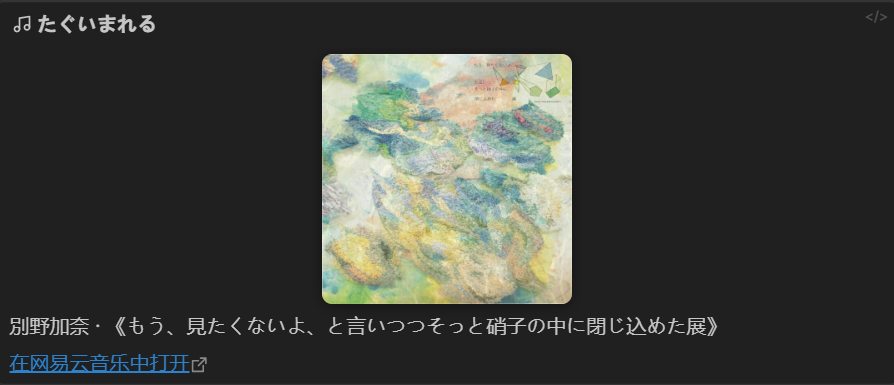

# NetEase Music Card

在 Obsidian 中粘贴网易云音乐的歌曲链接，自动生成包含歌曲名、歌手、专辑和封面的歌曲卡片。封面可以保存到本地仓库，重复粘贴不会重复下载。


## 快速开始

1. 打开本仓库的 **Releases** 页面，下载最新版本中的 `manifest.json`、`main.js`、`styles.css`。
2. 把这三个文件放到你的 Obsidian 仓库：

   ```
   <你的仓库>/.obsidian/plugins/netease-music-card/
   ```

3. 重启 Obsidian，在「设置 → 第三方插件」中关闭安全模式，启用 **NetEase Music Card**。
4. 在任意 Markdown 笔记中粘贴网易云歌曲链接，稍等片刻即可看到歌曲卡片。

Windows 路径示例：

```
C:\Users\你的用户名\Documents\MyVault\.obsidian\plugins\netease-music-card\
```

## 效果

粘贴：

```text
https://music.163.com/song?id=421807904&uct2=U2FsdGVkX18C86nvptSGB87RvOKtOyNTjg8PWOKrQ6E=
```

生成的笔记内容如下（在 Obsidian 中会显示为带封面的 Callout 卡片）：

```markdown
> [!netease] たぐいまれる
>
> ![[attachments/netease/421807904.jpg|200]]
>
> 別野加奈 · 《もう、見たくないよ、と言いつつそっと硝子の中に閉じ込めた展》
>
> [在网易云音乐中打开](https://music.163.com/song?id=421807904)
```




## 功能

- 粘贴网易云歌曲链接后自动替换为歌曲卡片
- 自动获取歌曲名、歌手、专辑和封面
- 支持网易云 App 的完整分享文案，可自动清理「分享……来自@网易云音乐」等文字
- 封面下载到本地仓库，重复粘贴不会重复下载；下载失败时自动使用远程图片
- 支持 Callout 卡片和纯 Markdown 两种样式
- 支持完整链接、移动端链接、路径形式链接和 `163cn.tv` 短链接
- 提供命令面板、编辑器右键菜单、侧边栏图标等多种插入方式
- 可以把已经存在的网易云链接转换为卡片
- 支持桌面端和移动端

## 安装

### 方式一：从 Release 安装（推荐）

1. 打开仓库的 **Releases** 页面。
2. 下载最新 Release 中的三个文件：

   - `manifest.json`
   - `main.js`
   - `styles.css`

3. 在 Obsidian 仓库中创建目录：

   ```
   <你的仓库>/.obsidian/plugins/netease-music-card/
   ```

4. 把三个文件放入该目录。
5. 重启 Obsidian，或执行命令面板中的「Reload app without saving」。
6. 打开「设置 → 第三方插件」，关闭安全模式，找到并启用 **NetEase Music Card**。

> 如果 Release 中还没有构建文件，可以先使用下方「方式三：从源码构建」。

### 方式二：通过 BRAT 安装

适合需要跟随仓库最新提交的用户。

1. 安装并启用 [BRAT](https://github.com/TfTHacker/obsidian42-brat)。
2. 打开命令面板，执行 `BRAT: Add a beta plugin for testing`。
3. 输入仓库地址：

   ```
   <你的 GitHub 用户名>/obsidian-netease-music-card
   ```

4. 点击添加，然后在第三方插件中启用 **NetEase Music Card**。

> BRAT 需要仓库中存在可用的 Release，请先完成一次发布。

### 方式三：从源码构建

需要 Node.js 18 或更高版本。

```bash
git clone https://github.com/<你的 GitHub 用户名>/obsidian-netease-music-card.git
cd obsidian-netease-music-card
npm install
npm run build
```

构建完成后，把以下三个文件复制到 `<你的仓库>/.obsidian/plugins/netease-music-card/`：

```
main.js
manifest.json
styles.css
```

开发时可以使用监听模式：

```bash
npm run dev
```

`npm run dev` 会监听 `src/` 下的源码并重新生成 `main.js`。配合 [Hot Reload](https://github.com/pjeby/hot-reload) 可以免去反复重启 Obsidian 的麻烦。

## 使用

### 1. 直接粘贴链接

在 Markdown 笔记中粘贴以下任意一种链接：

```
https://music.163.com/song?id=421807904
https://music.163.com/#/song?id=421807904
https://music.163.com/song/421807904
https://y.music.163.com/m/song?id=421807904
https://163cn.tv/xxxxxx
```

插件会自动获取歌曲信息、下载封面，并把链接替换成卡片。

### 2. 粘贴 App 分享文案

网易云 App 的分享内容通常长这样：

```
分享別野加奈的单曲《たぐいまれる》: https://music.163.com/song?id=421807904&uct2=... (来自@网易云音乐)
```

直接粘贴即可。插件会识别其中的歌曲链接，并且只保留歌曲卡片。如果希望保留分享文案，可以在设置中关闭「清理分享文案」。

### 3. 通过命令插入

| 操作 | 入口 |
| --- | --- |
| 插入一首网易云歌曲 | 命令面板：`插入网易云歌曲` |
| 把已有链接转为卡片 | 选中链接后执行：`把选中的网易云链接转换为卡片` |
| 插入歌曲 | 编辑器右键菜单：`插入网易云歌曲` |
| 插入歌曲 | 左侧边栏音乐图标 |

执行「插入网易云歌曲」时，如果剪贴板里已经有网易云链接，会自动填入输入框；没有的话也可以手动粘贴。

### 4. 封面保存位置

默认保存到：

```
<你的仓库>/attachments/netease/<歌曲ID>.jpg
```

例如：

```
attachments/netease/421807904.jpg
```

封面以 600 × 600 的尺寸下载，卡片中默认显示为 200 像素宽。可以在设置中修改保存目录和显示宽度。

同一首歌再次粘贴时会复用已经下载的封面，不会重复请求图片。

### 支持的链接格式

- `https://music.163.com/song?id=...`
- `https://music.163.com/#/song?id=...`
- `https://music.163.com/song/...`
- `https://y.music.163.com/m/song?id=...`
- `https://163cn.tv/...`（短链接）

仅支持单曲链接。专辑、歌单、电台等链接不会被处理。

## 设置

| 设置 | 默认值 | 说明 |
| --- | --- | --- |
| 保存封面到本地 | 开启 | 关闭后卡片直接引用网易云远程图片 |
| 封面文件夹 | `attachments/netease` | 相对于仓库根目录；留空则保存到根目录 |
| 封面宽度 | `200` | 卡片中封面的显示宽度，0 表示原始大小 |
| 卡片样式 | Callout 卡片 | 可选 Callout 卡片或纯 Markdown |
| 显示专辑名 | 开启 | 在歌手后面显示所属专辑 |
| 显示「在网易云音乐中打开」 | 开启 | 在卡片底部添加原曲页面链接 |
| 清理分享文案 | 开启 | 粘贴 App 分享文案时去掉多余文字 |

设置入口：Obsidian 设置 → 第三方插件 → NetEase Music Card → 选项。

## 工作原理

1. 监听 Markdown 编辑器的粘贴事件，识别文本中的网易云歌曲链接。
2. 使用 Obsidian 的 `requestUrl` 请求网易云公开接口获取歌曲信息；接口不可用时自动回退到解析歌曲页面的 Open Graph 信息。
3. 下载封面，并通过 `vault.createBinary` 写入本地仓库。
4. 先把链接替换成临时占位标记，信息获取完成后再替换为最终卡片，避免阻塞粘贴操作。

插件只会向 `music.163.com` 和网易云图片域名发送歌曲 ID、图片请求，不会上传笔记内容或账号信息。

## 常见问题

### 粘贴后没有生成卡片

- 确认链接是单曲链接，而不是专辑、歌单或电台链接。
- 确认网络可以访问 `music.163.com`。
- 打开开发者工具控制台查看是否有 `netease-music-card` 相关错误。
- 如果链接没有被替换，检查是否在设置中关闭了插件，或者粘贴位置在特殊代码块中。

### 提示「网易云歌曲获取失败」

网易云接口可能临时限流、变更或对当前网络不可用。可以：

- 稍后重试。
- 确认能正常打开对应的网易云歌曲页面。
- 更新到最新版本插件。

失败时插件会把原链接保留在笔记中，不会丢失内容。

### 封面没有保存到本地

- 检查「保存封面到本地」是否开启。
- 检查「封面文件夹」是否是合法的仓库路径。
- 确认仓库有写入权限。
- 封面下载失败时，插件会提示并自动退回使用远程图片；卡片仍然可以正常显示。

### 换了封面但笔记里还是旧图

封面文件名使用歌曲 ID，旧文件不会被自动覆盖。删除对应的 `<歌曲ID>.jpg` 文件后重新粘贴即可重新下载。

### 卡片没有颜色或音乐图标

确认 `styles.css` 已经放到插件目录中，并重新加载 Obsidian。

### 支持手机端吗？

插件声明为 `isDesktopOnly: false`，支持桌面端和移动端。移动端的剪贴板命令可能受系统权限限制，直接粘贴链接通常不受影响。

## 开发

环境要求：

- Node.js 18+
- npm 9+

常用命令：

```bash
npm install     # 安装依赖
npm run dev     # 监听源码并构建
npm run build   # 类型检查 + 生产构建
npm run check   # 只做 TypeScript 类型检查
```

项目结构：

```
.
├── manifest.json
├── styles.css
├── src/
│   ├── main.ts      # 插件入口、粘贴/命令处理
│   ├── links.ts     # 链接识别与分享文案判断
│   ├── netease.ts   # 歌曲信息获取、封面下载
│   ├── card.ts      # 卡片 Markdown 渲染
│   ├── modal.ts     # 插入歌曲输入框
│   ├── settings.ts  # 设置页
│   └── types.ts     # 类型与默认设置
├── .github/
│   └── workflows/   # CI 与自动发布
├── esbuild.config.mjs
├── tsconfig.json
└── package.json
```

`main.js` 是构建产物，已加入 `.gitignore`，由 GitHub Actions 在发布时自动生成并附加到 Release。

## 已知限制

- 使用的是网易云公开页面和接口，属于非官方接口，未来可能发生变化。
- 封面文件名使用歌曲 ID，歌曲更换封面后旧文件不会自动更新，删除对应文件再粘贴即可重新下载。
- 在代码块等特殊位置粘贴时也会触发转换。
- 插件与网易云音乐官方没有关联，请遵守网易云音乐的服务条款，仅用于个人学习和使用。

## License

[MIT](LICENSE)
